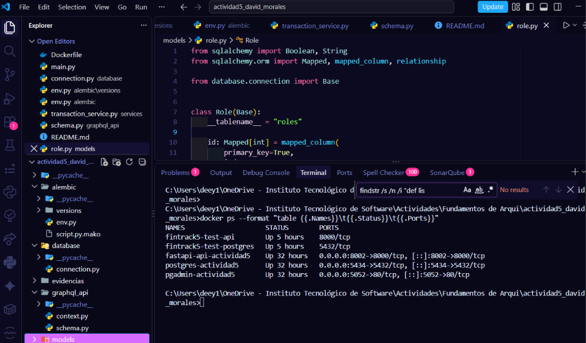
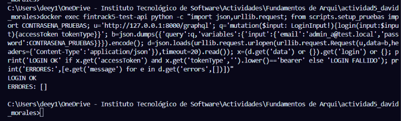
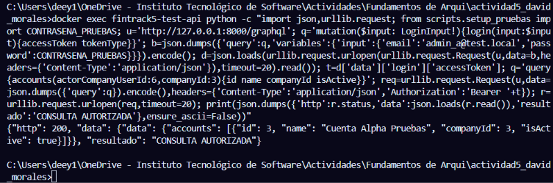
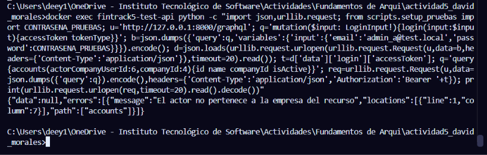
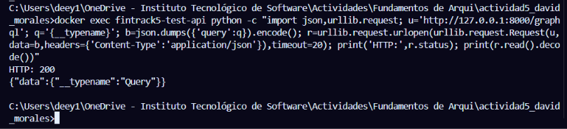
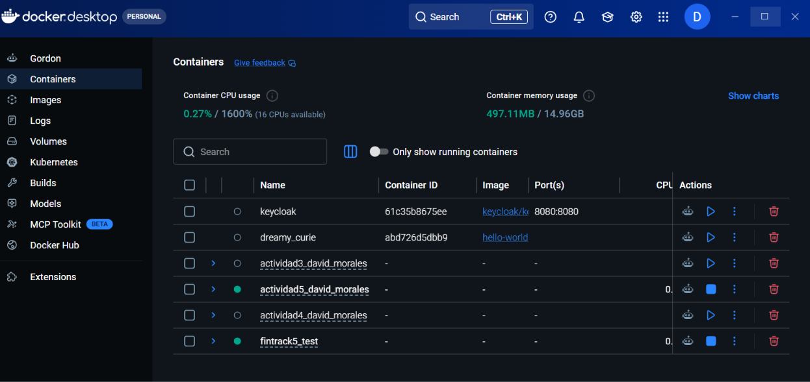
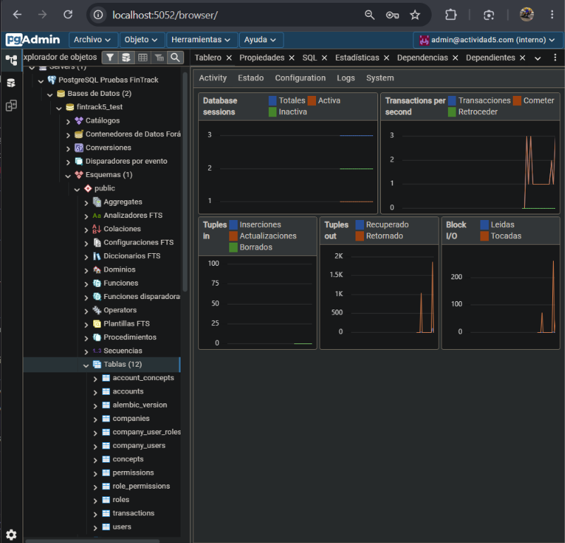

# FinTrack-5

Backend para la gestión de cuentas, conceptos y movimientos financieros.

## Descripción

FinTrack-5 es una aplicación backend desarrollada para gestionar empresas, usuarios, cuentas financieras, conceptos de ingresos y egresos, relaciones entre cuentas y conceptos, y movimientos financieros.

La aplicación expone sus operaciones mediante GraphQL y utiliza una arquitectura por capas para separar la API, la lógica de negocio, el acceso a datos y la persistencia.

El proyecto integra autenticación mediante JWT para identificar al usuario responsable de registrar cada movimiento financiero.

## Contenido

- [Descripción](#descripción)
- [Arquitectura](#arquitectura)
- [Módulos principales](#módulos-principales)
- [Tecnologías](#tecnologías)
- [Estructura del proyecto](#estructura-del-proyecto)
- [GraphQL](#graphql)
- [Autenticación](#autenticación)
- [Gestión de movimientos](#gestión-de-movimientos)
- [Regla financiera](#regla-financiera)
- [Datos mínimos implementados](#datos-mínimos-implementados)
- [Validaciones probadas](#validaciones-probadas)
- [Evidencias](#evidencias)
- [Configuración del entorno](#configuración-del-entorno)
- [Ejecución con Docker](#ejecución-con-docker)
- [Migraciones](#migraciones)
- [Actividad 3 — Autorización con roles y control de acceso](#actividad-3--autorización-con-roles-y-control-de-acceso)
- [Actividad 4 — Configuración de permisos por roles](#actividad-4--configuración-de-permisos-por-roles)
- [Actividad 5 — Configuración de permisos con GraphQL (Unidad II)](#actividad-5--configuración-de-permisos-con-graphql-unidad-ii)
- [Verificación de la aplicación](#verificación-de-la-aplicación)
- [Control de versiones](#control-de-versiones)
- [Seguridad](#seguridad)
- [Referencias](#referencias)
- [Estado del proyecto](#estado-del-proyecto)

## Arquitectura

La aplicación utiliza una arquitectura por capas con la siguiente estructura:

    GraphQL
        |
        v
    Services
        |
        v
    Repositories
        |
        v
    SQLAlchemy
        |
        v
    PostgreSQL

Cada capa tiene una responsabilidad específica:

- GraphQL: recibe las consultas y mutaciones del cliente.
- Services: contiene las reglas de negocio y validaciones.
- Repositories: concentra las operaciones de acceso a datos.
- SQLAlchemy: proporciona el mapeo entre objetos Python y tablas de PostgreSQL.
- PostgreSQL: almacena la información persistente del sistema.

## Módulos principales

- Gestión de empresas.
- Gestión de usuarios.
- Relación empresa-usuario.
- Gestión de cuentas financieras.
- Gestión de conceptos de ingresos y egresos.
- Relación cuenta-concepto.
- Gestión de movimientos financieros.
- Autenticación mediante JWT.
- Hash de contraseñas mediante Argon2.
- API GraphQL.
- Persistencia con PostgreSQL.
- Migraciones mediante Alembic.
- Contenedores mediante Docker Compose.

## Tecnologías

- Python 3.11
- FastAPI
- Strawberry GraphQL
- SQLAlchemy
- PostgreSQL 16
- Alembic
- Docker
- Docker Compose
- PyJWT
- pwdlib
- Argon2
- psycopg

## Estructura del proyecto

    FinTrack-5/
    ├── alembic/
    │   ├── versions/
    │   ├── env.py
    │   └── script.py.mako
    ├── database/
    │   └── connection.py
    ├── graphql_api/
    │   ├── context.py
    │   └── schema.py
    ├── models/
    │   ├── account.py
    │   ├── account_concept.py
    │   ├── company.py
    │   ├── company_user.py
    │   ├── company_user_role.py
    │   ├── concept.py
    │   ├── permission.py
    │   ├── role.py
    │   ├── role_permission.py
    │   ├── transaction.py
    │   └── user.py
    ├── repositories/
    │   ├── account_repository.py
    │   ├── account_concept_repository.py
    │   ├── company_repository.py
    │   ├── company_user_repository.py
    │   ├── company_user_role_repository.py
    │   ├── concept_repository.py
    │   ├── permission_repository.py
    │   ├── role_repository.py
    │   ├── role_permission_repository.py
    │   ├── transaction_repository.py
    │   └── user_repository.py
    ├── security/
    │   ├── __init__.py
    │   ├── jwt.py
    │   └── password.py
    ├── services/
    │   ├── account_service.py
    │   ├── account_concept_service.py
    │   ├── auth_service.py
    │   ├── authorization_service.py
    │   ├── company_user_service.py
    │   ├── concept_service.py
    │   ├── permission_service.py
    │   ├── role_permission_service.py
    │   ├── role_service.py
    │   ├── seed_service.py
    │   └── transaction_service.py
    ├── scripts/
    │   ├── setup_pruebas.py
    │   └── limpiar_pruebas.py
    ├── evidencias/
    ├── .dockerignore
    ├── .env.example
    ├── .env.test.example
    ├── .gitignore
    ├── Dockerfile
    ├── README.md
    ├── alembic.ini
    ├── compose.yaml
    ├── compose.test.yaml
    ├── main.py
    └── requirements.txt

## GraphQL

La API GraphQL está disponible en:

    http://localhost:8002/graphql

### Queries

Las principales consultas implementadas son:

- `accounts`
- `account`
- `concepts`
- `concept`
- `accountConcepts`
- `transactions`
- `companyUsers`

### Mutations

Las principales mutaciones implementadas son:

- `login`
- `createAccount`
- `createConcept`
- `assignConceptToAccount`
- `removeConceptFromAccount`
- `createTransaction`
- `deleteTransaction`

## Autenticación

El sistema utiliza JSON Web Tokens para autenticar al usuario que registra movimientos.

Primero se debe ejecutar la mutación `login` utilizando las credenciales correspondientes.

    mutation {
      login(
        input: {
          email: "correo_del_usuario"
          password: "contraseña"
        }
      ) {
        accessToken
        tokenType
      }
    }

El resultado proporciona un `accessToken`.

Para ejecutar operaciones protegidas se debe enviar el token mediante el encabezado HTTP:

    Authorization: Bearer <accessToken>

El movimiento financiero no recibe directamente el usuario desde el cliente. El usuario se obtiene a partir del token autenticado y se registra automáticamente en el campo `capturedBy`.

## Gestión de movimientos

Los movimientos utilizan dos tipos:

- `INCOME`: ingreso.
- `EXPENSE`: egreso.

Los movimientos deben cumplir las siguientes validaciones:

- El monto debe ser mayor que cero.
- La cuenta debe existir.
- La cuenta debe estar activa.
- El concepto debe existir.
- El concepto debe estar activo.
- El concepto debe estar permitido para la cuenta.
- El usuario debe estar autenticado.
- El usuario debe pertenecer a la empresa correspondiente.
- La cuenta y el concepto deben pertenecer a la misma empresa.
- El tipo del movimiento debe coincidir con el tipo del concepto.

El usuario responsable se registra mediante `capturedBy`.

La eliminación de movimientos se maneja de forma lógica mediante el campo `isActive`.

## Regla financiera

Los movimientos utilizan montos positivos.

El comportamiento financiero se determina por el tipo de movimiento:

- `INCOME`: representa un ingreso.
- `EXPENSE`: representa un egreso.

El saldo financiero se obtiene conceptualmente mediante:

    Balance = SUM(INCOME) - SUM(EXPENSE)

## Datos mínimos implementados

Como parte de la actividad se generaron los datos mínimos solicitados:

- 3 cuentas.
- 5 conceptos de ingreso.
- 5 conceptos de egreso.
- 10 relaciones cuenta-concepto.
- Más de 20 movimientos de prueba, incluyendo ingresos y egresos.

También se realizaron pruebas de validación mediante GraphQL.

## Validaciones probadas

Se probaron casos correctos y casos de error, incluyendo:

- Creación de un movimiento con usuario autenticado.
- Registro del usuario responsable mediante `capturedBy`.
- Monto igual a cero.
- Cuenta inexistente.
- Concepto inexistente.
- Concepto no permitido para una cuenta.
- Tipo de movimiento incompatible con el concepto.
- Consulta de movimientos.
- Eliminación lógica de movimientos.
- Prevención de relaciones cuenta-concepto duplicadas.
- Prevención de conceptos duplicados.

## Evidencias

Las evidencias del proyecto se encuentran en la carpeta [`evidencias/`](evidencias/).

### Evidencias visuales de la Actividad 5 (entorno de pruebas, autorización y control de acceso)

Las siguientes siete capturas documentan el despliegue del entorno de pruebas aislado y el comportamiento del sistema con roles, autorización por empresa y control de acceso.

#### 1. Contenedores de pruebas

Salida de `docker ps` en la terminal del proyecto. Se observan los contenedores del entorno de pruebas aislado (`fintrack5-test-api` y `fintrack5-test-postgres`) junto con los contenedores del entorno de desarrollo (`fastapi-api-actividad5`, `postgres-actividad5` y `pgadmin-actividad5`), todos en ejecución.

#### 2. Inicio de sesión del administrador de Alpha

Ejecución de la mutación `login` contra el endpoint GraphQL del entorno de pruebas con el usuario administrador de la empresa Alpha. La respuesta confirma el inicio de sesión correcto (`LOGIN OK`) sin errores. La contraseña se toma de la variable de prueba del script de seed; ni la contraseña ni el token de acceso se muestran en la captura.

#### 3. Consulta autorizada de una cuenta de Alpha

Consulta `accounts` autenticada con el administrador de Alpha (`actorCompanyUserId: 6`, `companyId: 3`). El servidor responde con HTTP 200 y devuelve la cuenta "Cuenta Alpha Pruebas" de la empresa 3, demostrando una consulta autorizada dentro de la propia empresa del actor.

#### 4. Rechazo de acceso al no pertenecer a la empresa del recurso

Misma consulta `accounts` realizada por el actor de Alpha, pero solicitando los recursos de la empresa Beta (`companyId: 4`). El servidor responde con el error `El actor no pertenece a la empresa del recurso`, evidenciando el aislamiento entre empresas: un usuario autenticado no puede leer datos de una empresa a la que no pertenece.

#### 5. Respuesta válida de GraphQL

Consulta de introspección mínima (`{__typename}`) enviada directamente al endpoint GraphQL del entorno de pruebas. El servidor responde con HTTP 200 y `{"data": {"__typename": "Query"}}`, confirmando que el esquema carga y responde correctamente sin necesidad de autenticación para operaciones públicas.

#### 6. Estado de los contenedores en Docker Desktop

Vista de contenedores de Docker Desktop. Se observan los grupos de contenedores del proyecto: `actividad5_david_morales` (entorno de desarrollo) y `fintrack5_test` (entorno de pruebas aislado), ambos en ejecución.

#### 7. Tablas de PostgreSQL de las pruebas en pgAdmin

pgAdmin conectado al servidor de pruebas y a la base de datos `fintrack5_test`. En el explorador de objetos se listan las 12 tablas del esquema (`accounts`, `account_concepts`, `companies`, `company_users`, `company_user_roles`, `concepts`, `permissions`, `role_permissions`, `roles`, `transactions`, `users` y `alembic_version`), confirmando que el esquema de la Actividad 3 está desplegado en el entorno de pruebas.

### Capturas de las pruebas de negocio y validaciones

Las capturas anteriores corresponden a pruebas funcionales de las operaciones financieras (creación de cuentas, conceptos, relaciones y movimientos):

- `01_create_account_success.png` — creación correcta de una cuenta.
- `02_accounts_minimum_3.png` — consulta de las cuentas creadas.
- `03_income_concepts_5.png` — conceptos de ingreso.
- `04_expense_concepts_5.png` — conceptos de egreso.
- `05_account_concept_relations_10.png` — relaciones cuenta-concepto.
- `06_duplicate_account_concept_error.png` — validación de relación duplicada.
- `08_transaction_income_authenticated.png` — creación de movimiento autenticado.
- `09_transaction_amount_validation.png` — validación de monto mayor que cero.
- `10_transaction_concept_account_validation.png` — validación de concepto permitido para la cuenta.
- `11_transaction_type_validation.png` — validación de compatibilidad entre movimiento y concepto.
- `12_transaction_account_not_found.png` — validación de cuenta inexistente.
- `13_transaction_concept_not_found.png` — validación de concepto inexistente.
- `14_transaction_income_success.png` — creación y consulta de movimiento de ingreso.
- `15_transaction_expense_success.png` — creación y consulta de movimiento de egreso.
- `17_transaction_delete_success.png` — eliminación lógica de un movimiento.

## Configuración del entorno

Antes de ejecutar el proyecto se debe crear un archivo `.env` tomando como referencia `.env.example`.

El archivo `.env` contiene las variables necesarias para configurar:

- Aplicación.
- PostgreSQL.
- pgAdmin.
- JWT.

El archivo `.env` está excluido del repositorio mediante `.gitignore`.

## Ejecución con Docker

Para iniciar los servicios:

    docker compose up -d

Para comprobar el estado de los contenedores:

    docker compose ps

La aplicación principal estará disponible en:

    http://localhost:8002

GraphQL estará disponible en:

    http://localhost:8002/graphql

PostgreSQL estará expuesto localmente mediante:

    localhost:5434

pgAdmin estará disponible en:

    http://localhost:5052

## Migraciones

Para aplicar las migraciones:

    docker compose exec api alembic upgrade head

Para consultar la migración actual:

    docker compose exec api alembic current

La migración actual utilizada por el proyecto es:

    3b9f41c7d2ae (head)

Migraciones existentes (orden):

    1f16b37ae1a4  base inicial (Actividad 5)
    2ceeae7ff07c  esquema financiero
    3b9f41c7d2ae  roles y permisos (Actividad 3)

## Actividad 3 — Autorización con roles y control de acceso

### Arquitectura de autorización

Las 25 operaciones GraphQL (10 queries y 15 mutations) pasan por
`services/authorization_service.py`, que expone `exigir_permiso`:

- Exige el permiso exacto (código) del rol activo de la membresía del
  actor en la empresa indicada (`actorCompanyUserId`).
- Aplica scope por empresa para recursos de negocio (cuentas,
  conceptos, transacciones, membresías y asignación de roles).
- El catálogo de roles y permisos es global (sin scope): las
  operaciones de catálogo exigen `roles.read` / `roles.write`.
- `is_admin` NO es un bypass: el alta como administrador asigna el
  rol ADMINISTRADOR con todos los permisos, pero toda operación sigue
  exigiendo el permiso correspondiente.
- Los errores de autorización se devuelven como errores GraphQL
  (HTTP 200 con payload `errors`), con mensajes fijos del código.

### Roles oficiales

- ADMINISTRADOR (protegido: no se puede desactivar ni retirarle
  `roles.write`).
- CONTADOR
- CAPTURISTA
- CONSULTA

### Permisos (catálogo de 10)

- company.users.read, company.users.write
- accounts.read, accounts.write
- concepts.read, concepts.write
- transactions.read, transactions.write
- roles.read, roles.write

### Módulos de la Actividad 3

- `services/authorization_service.py` — `exigir_permiso` y scope.
- `services/role_service.py`, `services/permission_service.py`,
  `services/role_permission_service.py` — catálogo.
- `services/company_user_service.py` — membresías empresa-usuario y
  asignación de roles.
- `services/seed_service.py` — roles y permisos iniciales.
- `repositories/role_repository.py`, `permission_repository.py`,
  `role_permission_repository.py`, `company_user_repository.py`,
  `company_user_role_repository.py`.
- Migración `3b9f41c7d2ae_roles_y_permisos.py`.

### Endurecimiento de autorización (corrección Actividad 5)

Correcciones aplicadas sobre la base de roles (evidencia completa en
`evidencias/actividad3/correcciones/`):

- `get_transaction_service` exige ahora `transactions.read` con scope
  de la cuenta de la transacción (antes era un servicio de lectura sin
  autorización); se eliminó su import muerto en `graphql_api/schema.py`.
- `deactivate_company_user_service` es atómica (membresía + roles en un
  solo commit con rollback) y aplica el guard del último administrador
  con mensaje fijo:
  `No se puede desactivar al último administrador de la empresa`
  (alcance: no queda ninguna membresía activa con rol ADMINISTRADOR
  activo en la empresa).
- `assign_role_service` rota el rol en una sola transacción; requiere
  `db.flush()` tras desactivar por el índice único parcial
  `uq_company_user_role_active(company_user_id) WHERE is_active`.
- Nueva query `companyUsers` (con `company.users.read` y scope por
  empresa): argumentos `actorCompanyUserId`, `companyId`, `activeOnly`
  (por defecto `true`).
- `create_company_admin_service` sigue siendo de uso exclusivo de
  bootstrap: solo se documentó, la lógica no cambió.

Decisiones aceptadas y documentadas (sin cambio de código):

- El catálogo de roles/permisos sigue siendo **global** (sin scope por
  empresa): un ADMINISTRADOR de una empresa puede alterar el catálogo
  que usan las demás. Aceptado y documentado.
- Riesgo de enumeración en login (F7): el mensaje propio de usuario
  inactivo permite discernir existencia de cuentas inactivas. Aceptado;
  los mensajes no se modifican.

Pendientes explícitos de la fase de corrección (NO ejecutados, NO
dados por aprobados): N10 (idempotencia de `setup_pruebas.py` +
dry-run de `limpiar_pruebas.py`) y la verificación de rollback por
inyección de fallo. Ambos requieren escribir en la base de datos y
quedaron fuera de autorización.

### Entorno de pruebas aislado (compose.test.yaml)

Existe un overlay de Compose, `compose.test.yaml`, que:

- Renombra los contenedores (`fintrack5-test-api`,
  `fintrack5-test-postgres`) y usa el volumen `fintrack5_test_pgdata`.
- Elimina la publicación de puertos (`ports: !reset []`): la API y la
  base solo son accesibles desde dentro de la red de Docker.
- Fija `DB_HOST=postgres` y `DB_NAME` a la base de pruebas
  `fintrack5_test` (distinta de la base de desarrollo `actividad5`).

Invocación canónica (desde la raíz del repo):

    docker compose -p fintrack5_test --env-file .env.test \
      -f compose.yaml -f compose.test.yaml <comando>

### Configuración del entorno de pruebas

Copia la plantilla y completa los valores ficticios que desees:

    cp .env.test.example .env.test

`.env.test` está excluido de Git (`.gitignore` y `.dockerignore`).
La plantilla solo incluye nombres de variables y valores de ejemplo;
no contiene credenciales reales.

Variables requeridas por `compose.test.yaml` (interpolación):
`POSTGRES_DB`, `POSTGRES_USER`, `POSTGRES_PASSWORD`, `JWT_SECRET`
(Actividad 6; sustituye a `JWT_SECRET_KEY`).
El servicio `pgadmin` (perfil `herramientas`) usa además
`PGADMIN_EMAIL` y `PGADMIN_PASSWORD`; las variables `APP_PORT`,
`POSTGRES_PORT` y `PGADMIN_PORT` se mantienen solo para la
interpolación del `compose.yaml` base.

### Preparación, pruebas y limpieza (solo sobre fintrack5_test)

Los scripts viven en `scripts/` y NO están dentro de la imagen: cópialos
al contenedor antes de ejecutarlos.

    docker compose -p fintrack5_test --env-file .env.test \
      -f compose.yaml -f compose.test.yaml cp scripts/setup_pruebas.py api:/app/scripts/setup_pruebas.py

    docker compose -p fintrack5_test --env-file .env.test \
      -f compose.yaml -f compose.test.yaml exec -T -e PYTHONPATH=/app api \
      python /app/scripts/setup_pruebas.py

Para limpiar (primero simula; aplica solo con `--confirm`):

    ... exec -T -e PYTHONPATH=/app api python /app/scripts/limpiar_pruebas.py
    ... exec -T -e PYTHONPATH=/app api python /app/scripts/limpiar_pruebas.py --confirm

ADVERTENCIAS:

- Ambos scripts se niegan a ejecutarse si `DB_NAME` no es
  `fintrack5_test` o si `DB_HOST` no es `postgres`: nunca apuntan a la
  base de desarrollo.
- `limpiar_pruebas.py` borra datos ficticios de `fintrack5_test` (las
  empresas "Pruebas Alpha SA" y "Pruebas Beta SA" y sus recursos);
  ejecuta primero sin `--confirm`.
- `limpiar_pruebas.py` también retira el residuo de pruebas de
  `role_permissions`: las relaciones fuera de la matriz oficial que los
  escenarios dejan inactivas al conceder y retirar permisos (por ejemplo
  `CAPTURISTA/accounts.write` de la Actividad 4 y de la suite A5). Las
  26 relaciones oficiales del catálogo nunca se eliminan. Sin esta
  limpieza, `setup_pruebas.py` abortaría con "par no oficial" en la
  siguiente inicialización.
- No ejecutes estos scripts contra la base de desarrollo `actividad5`.

Las pruebas funcionales de autorización (matriz de 89 registros) están
documentadas en `evidencias/actividad3/funcionales/`.

## Actividad 4 — Configuración de permisos por roles

### Queries añadidas (aliases)

Se añaden tres queries sin eliminar las existentes (decisión acordada):

| Query nueva | equivalente existente | argumentos |
|---|---|---|
| `roles` | `listRoles` | `actorCompanyUserId: Int!` |
| `permissions` | `listPermissions` | `actorCompanyUserId: Int!` |
| `rolePermissions` | `listRolePermissions` | `actorCompanyUserId: Int!`, `roleId: Int!` |

Ambas rutas delegan en los mismos helpers de módulo
(`_resolver_list_roles`, `_resolver_list_permissions`,
`_resolver_list_role_permissions`) y en los mismos servicios con exigencia
de permiso: una sola fuente de verdad. El SDL resultante expone
13 queries y 15 mutations.

### Usuarios del guion (fixtures)

`scripts/setup_pruebas.py` crea en la fase 5b (función idempotente
`preparar_usuarios_actividad4`) los usuarios nombrados del guion, todos
en Pruebas Alpha SA:

| usuario | correo | rol inicial |
|---|---|---|
| Ana | ana@test.local | ADMINISTRADOR |
| Luis | luis@test.local | CONTADOR |
| María | maria@test.local | CAPTURISTA |
| José | jose@test.local | CAPTURISTA |
| Pedro | pedro@test.local | CONSULTA |

Ninguno se crea con `is_admin=True`: la regla de negocio admite un solo
administrador principal por empresa (admin_a lo es) y la autorización
depende del rol activo, no de esa bandera. Con esto la base de pruebas
queda en users=12, company_users=10, company_user_roles=10 activas.

### Escenarios (`scripts/pruebas_actividad4.py`)

Runner con 34 casos (grupos V1–V10) que solo se ejecuta contra
`fintrack5_test` (mismas guardas que los demás scripts). Restaura la
matriz oficial y el rol inicial de Pedro incluso ante errores (bloque
`finally`), siempre con bajas lógicas (`is_active=false`), nunca con
DELETE. Escribe el detalle en JSONL dentro del contenedor
(`/tmp/actividad4_resultados.jsonl`).

Corrida oficial (12-oct-2026, exit code 0): **34/34 APROBADOS**.
Re-verificada tras los cambios de la Actividad 5 (14-oct-2026, exit
code 0): **34/34 APROBADOS**.

| grupo | casos | cobertura |
|---|---|---|
| V1 | 6/6 | aliases `roles`/`permissions`/`rolePermissions` iguales a sus `list*` |
| V2 | 2/2 | catálogo de 4 roles y 10 permisos sin duplicados |
| V3 | 6/6 | creación de cuentas denegada/concedida según `accounts.write` |
| V4 | 3/3 | concesión y retiro de permiso (fila histórica conservada) |
| V5 | 5/5 | rotación de rol de Pedro (CONSULTA→CAPTURISTA→CONSULTA) y transacción |
| V6 | 2/2 | permisos de CONTADOR y CONSULTA intactos durante la prueba |
| V7 | 4/4 | concesión/retiro de `roles.write` por parte de Ana |
| V8 | 2/2 | sin escrituras en la base tras cada denegación |
| V9 | 3/3 | matriz final 10/8/4/4 idéntica al baseline |
| V10 | 1/1 | SELECT final de `role_permissions` (26 filas activas) |

### Matriz oficial verificada (10/8/4/4)

| rol | permisos activos |
|---|---|
| ADMINISTRADOR | 10 |
| CONTADOR | 8 |
| CAPTURISTA | 4 |
| CONSULTA | 4 |
| **total** | **26** |

### Evidencias

Los archivos de `evidencias/actividad4/` documentan las pruebas automatizadas, el esquema y la matriz final:

| Archivo | Contenido |
|---|---|
| [`00_resumen.txt`](evidencias/actividad4/00_resumen.txt) | Resumen de ejecución y validaciones |
| [`01_esquema_graphql_sdl.txt`](evidencias/actividad4/01_esquema_graphql_sdl.txt) | Esquema GraphQL generado |
| [`02_resultados_runner.jsonl`](evidencias/actividad4/02_resultados_runner.jsonl) | Resultado individual de los 34 casos |
| [`03_salida_runner.txt`](evidencias/actividad4/03_salida_runner.txt) | Salida de consola del runner |
| [`04_role_permissions_final.txt`](evidencias/actividad4/04_role_permissions_final.txt) | Consulta SQL y matriz final de permisos |
| [`05_verificacion_bd.txt`](evidencias/actividad4/05_verificacion_bd.txt) | Estado de la base de pruebas y registros históricos |
| [`06_validaciones_estaticas.txt`](evidencias/actividad4/06_validaciones_estaticas.txt) | Validaciones estáticas |
| [`07_estado_git.txt`](evidencias/actividad4/07_estado_git.txt) | Estado de Git registrado durante la ejecución |
| [`08_resultados_graphql.json`](evidencias/actividad4/08_resultados_graphql.json) | Respuestas reales de `roles`, `permissions` y `rolePermissions` |

Las consultas GraphQL se ejecutaron con autenticación. El archivo JSON no incluye el token de acceso. Los resultados confirman cuatro roles, diez permisos y 26 asignaciones activas en la matriz oficial.

La evidencia SQL conserva además dos relaciones históricas inactivas, que no forman parte de las 26 asignaciones activas.

### Discrepancias conocidas

- El catálogo `roles`/`permissions`/`rolePermissions` no aplica scope
  por empresa: los servicios de catálogo son globales (decisión Q1
  aceptada en la fase de planificación), mientras el enunciado habla de
  catálogo "por empresa".
- El enunciado del profesor menciona MySQL; este repositorio usa
  PostgreSQL 16 con Alembic y Docker Compose (se conserva el stack).

## Actividad 5 — Configuración de permisos con GraphQL (Unidad II)

### Contrato añadido

| Operación | Tipo | Argumentos |
|---|---|---|
| `permissionCatalog` | query | `actorCompanyUserId: ID!`, `resource: PermissionResource = null` |
| `previewRolePermissions` | query | `input: SetRolePermissionsInput!`, `actorCompanyUserId: ID!` |
| `setRolePermissions` | mutation | `input: SetRolePermissionsInput!`, `actorCompanyUserId: ID!` |

> Nota D5 (Actividad 6): las tres filas anteriores documentan el
> contrato **histórico** de la Actividad 5. A partir de la Actividad 6
> las operaciones protegidas ya no reciben `actorCompanyUserId`: la
> identidad procede del token JWT (véase
> «Actividad 6 — Control de acceso según el rol»). Las evidencias
> E01–E11 de esta sección se conservan tal como se capturaron con el
> contrato histórico; `operaciones.graphql` y `variables/` sí se
> actualizaron al contrato autenticado para que el reproductor siga
> funcionando.

Tipos nuevos: enum `PermissionResource` (`COMPANY_USERS`, `ACCOUNTS`,
`CONCEPTS`, `TRANSACTIONS`, `ROLES`), input
`SetRolePermissionsInput { roleId: ID!, permissionIds: [ID!] }`,
`RolePermissionPlan` (`current` = configuración activa completa del rol
previa a la propuesta, `toActivate`, `toDeactivate`,
`unchanged`, `finalCount`) y `RolePermissionUpdate` (`activated`,
`deactivated`, `unchanged`, `finalCount`, `changed`). El SDL resultante
expone 15 queries y 16 mutations; las listas se ordenan por
`Permission.code` y las operaciones exigen `roles.read` (queries) o
`roles.write` (mutación) en el actor.

### Reglas de negocio implementadas

- `setRolePermissions` aplica la **lista exacta** de permisos en una
  sola transacción con un único `commit`; todas las validaciones ocurren
  antes de escribir; es idempotente (`changed=false` al repetir la misma
  propuesta).
- La reactivación reutiliza la fila existente conservando su `id`;
  unicidad de `(role_id, permission_id)` garantizada por
  `uq_role_permission` (sin migración).
- Toda propuesta sobre el rol `ADMINISTRADOR` se deniega;
  `permissionIds: []` es válido para los demás roles; los IDs repetidos
  se rechazan (`"3"` y `3` equivalen, pero no pueden duplicarse);
  permisos/roles inexistentes o inactivos se rechazan con mensajes
  exactos.
- La semilla (`services/seed_service.py`) distingue "nunca inicializado"
  (cero filas → crea la matriz oficial) de "vacío deliberado" (ya existen
  filas → nunca reactiva), por lo que `setup_pruebas.py` es idempotente
  y no restaura listas vacías.

### Pruebas automatizadas (`tests/`)

    docker exec -e PYTHONPATH=/app fintrack5-test-api \
      python -m unittest tests.test_configuracion_permisos -v

Guardas: `DB_NAME=fintrack5_test`, `DB_HOST=postgres`, revisión de
Alembic `3b9f41c7d2ae` (imposible ejecutarlas contra la base de
desarrollo). Resultado: **18/18** — catálogo con y sin filtro,
autorización, preview sin escrituras, aplicación S0→S1, idempotencia,
conservación del identificador, seis entradas inválidas, lista vacía con
no-restauración por el seed, rollback E07 (mock tras `flush`), matriz
oficial sin duplicados y semántica de `current` en previews con
desactivaciones.

### Evidencias E01–E10

Índice y detalle en [`evidencias.md`](evidencias.md); transcripciones
crudas en `evidencias/actividad5_configuracion_permisos/`:

| Evidencia | Contenido |
|---|---|
| E01 | Configuración inicial oficial (10/8/4/4) |
| E02 | Catálogo completo/por recurso + denegación sin `roles.read` |
| E03 | Preview S0→S1 sin escrituras |
| E04 | Aplicar S1 dos veces (`true` → `false`, id 31) |
| E05 | S0 → S1 conservando el mismo id de concesión |
| E06 | Seis entradas inválidas + actor sin `roles.write` (7/7) |
| E07 | Rollback controlado tras `flush` sin `commit` (OK) |
| E08 | Lista vacía + reinicio del contenedor (persiste 0 activas) |
| E09 | Restauración de la matriz oficial |
| E10 | Consulta de cuentas + movimiento real (cuenta 5, concepto 7, id 18) |

Cierre documental: la publicación del commit en GitHub y las
verificaciones de Git (15-oct-2026) se registran en
[`11_publicacion_git.txt`](evidencias/actividad5_configuracion_permisos/11_publicacion_git.txt).

### Entregables

| Archivo | Contenido |
|---|---|
| `operaciones.graphql` | `ExplorarCatalogo` (alias + fragmento `DatosPermiso`), `RevisarConfiguracion`, `AplicarConfiguracion` |
| `variables/` | Variables reales (actor 29, roles/permisos) para cada operación |
| `configuracion_inicial.json` / `configuracion_final.json` | Matriz por códigos antes y después |
| `comprobaciones.sql` | Consultas C1–C12 con resultados documentados |
| `investigacion.md` | Investigación con ≥3 fuentes oficiales verificadas (14-oct-2026) |
| `evidencias.md` | Índice y detalle de E01–E11 (incluye cierre de publicación) |
| `scripts/evidencias_actividad5.py` | Reproductor de las fases E01–E10 |

### Verificación final

Pruebas funcionales (ya registradas; sin re-ejecución en el cierre):

- Suite Actividad 5: **18/18 OK**.
- Regresión Actividad 4 (`scripts/pruebas_actividad4.py`): **34/34
  APROBADOS**.
- Matriz final oficial 10/8/4/4, sin duplicados y sin permisos fuera
  del catálogo (`comprobaciones.sql`).

Verificaciones de Git del cierre (15-oct-2026, detalle en
[`11_publicacion_git.txt`](evidencias/actividad5_configuracion_permisos/11_publicacion_git.txt)):

- `HEAD` = `origin/main` = `d33c5aa558d4ab87ce0293b1e11c0da87d3caae0`
  (commit publicado en GitHub; `git ls-remote` y `git fetch` exit 0).
- `git status --short --branch`: `## main...origin/main` limpio.
- `git diff --check HEAD`: exit 0, sin errores.

> Nota: el hash `d33c5aa…` anterior corresponde al estado **histórico**
> documentado al cerrar la Actividad 5 (15-oct-2026) y a su commit publicado;
> **no es el `HEAD` actual del repositorio**. El `HEAD` actual es `e85d9ef`
> (commit local que registra la verificación de esa publicación), y los cambios
> de la Actividad 6 permanecen locales, sin commit ni push. El detalle de la
> ejecución de cierre de A6 está en
> [`validacion_final.txt`](evidencias/actividad6_control_acceso/validacion_final.txt).

## Actividad 6 — Control de acceso según el rol (Unidad II)

La identidad de cada petición ya no viaja en el cuerpo de la operación:
se obtiene exclusivamente del token JWT enviado en el encabezado
`Authorization: Bearer <token>`. Las 30 operaciones protegidas (15
queries y 15 mutations) dejaron de exponer `actorCompanyUserId`;
`login` permanece público.

### Contrato de identidad

- `login` es público y responde `AuthPayload { token, tokenType, user }`
  (el ejemplo del documento: `tokenType`, `token` y `user { name }`).
  `user` es el tipo `User` mínimo (`id`, `name`, `email`) y nunca expone
  el hash; un login rechazado no entrega token.
- `security/jwt.py` firma y valida con **HS256** fijo y una vigencia de
  **30 minutos**; el payload contiene únicamente `companyUserId`,
  `companyId` y `exp` (UTC).
- El secreto se lee de la variable de entorno **`JWT_SECRET`**
  (renombrada desde `JWT_SECRET_KEY`); no hay valor por defecto ni
  fallback y su contenido nunca se registra.
- `graphql_api/context.py` valida la firma, la expiración, la membresía
  existente y activa, el usuario activo y la correspondencia
  `companyId` del token con la empresa de la membresía. Los fallos se
  reportan con mensajes tipificados: `Token inválido o expirado`,
  `La membresía no existe o está inactiva` y `El token no corresponde a
  la empresa de la membresía`.
- `graphql_api/schema.py` expone `_identidad(info)` como único
  mecanismo de identidad; `_validar_actor` fue eliminado.
- Los permisos de la Actividad 5 no cambian: cada operación conserva su
  llamada a `exigir_permiso` y el rol activo se consulta en la base de
  datos en cada petición, por lo que un token anterior refleja de
  inmediato el rol nuevo.

### Decisión D4 — usuarios con varias membresías activas

`get_active_company_user_by_user` selecciona la primera membresía activa
mediante `order_by(CompanyUser.id).first()`. Es una elección
determinista documentada; el cliente no elige empresa y el `companyId`
del token siempre proviene de esa membresía. Si el usuario no tiene una
membresía activa, el login se rechaza sin emitir token.

### Operaciones afectadas

Dejaron de recibir `actorCompanyUserId` las 30 operaciones protegidas:
consultas `accounts`, `companyUsers`, `account`, `concepts`, `concept`,
`accountConcepts`, `transactions`, `listRoles`/`roles`,
`listPermissions`/`permissions`,
`listRolePermissions`/`rolePermissions`, `permissionCatalog` y
`previewRolePermissions`; mutaciones `createAccount`, `createConcept`,
`assignConceptToAccount`, `removeConceptFromAccount`,
`createTransaction`, `deleteTransaction`, `createRole`,
`deactivateRole`, `createPermission`, `assignPermissionToRole`,
`removePermissionFromRole`, `setRolePermissions`, `createCompanyUser`,
`deactivateCompanyUser` y `assignRole`.

`createCompany` y el primer `createCompanyAdmin` no están expuestos hoy
como operaciones GraphQL; su alta sigue reservada a
`scripts/setup_pruebas.py` (comportamiento existente, sin cambios).

### Pruebas automatizadas (`tests/test_control_acceso_rol.py`)

    docker exec -e PYTHONPATH=/app fintrack5-test-api \
      python -m unittest tests.test_control_acceso_rol -v

Guardas: `DB_NAME=fintrack5_test`, `DB_HOST=postgres`, revisión de
Alembic y disponibilidad del endpoint. Resultado: **20/20 OK** —
respuesta de login (`token`, `tokenType`, datos mínimos del usuario y
ausencia de hash), claims con vigencia de 30 minutos, credenciales
inválidas, sin membresía, usuario inactivo, selección de membresía
múltiple, ausencia de `JWT_SECRET`, petición sin token, token alterado,
token vencido, `companyId` cruzado, membresía inactiva, contrato
GraphQL sin `actorCompanyUserId`, matriz de la Actividad 5 sin cambios y
los nueve casos funcionales. Cada rechazo de escritura comprueba además
que no se crearon registros.

### Evidencias E01–E10

Transcripciones en
[`evidencias/actividad6_control_acceso/`](evidencias/actividad6_control_acceso/)
(reproductor `scripts/evidencias_actividad6.py`; no se almacenan tokens
vigentes ni valores de secretos):

| Evidencia | Contenido |
|---|---|
| E01 | Login correcto (`token`, `tokenType` y datos mínimos del usuario) y rechazos |
| E02 | Operación sin token rechazada sin escrituras |
| E03 | María (CAPTURISTA) registra un movimiento válido |
| E04 | María no puede crear cuentas; sin escrituras |
| E05 | Luis (CONTADOR) crea una cuenta |
| E06 | Pedro (CONSULTA) no puede registrar movimientos |
| E07 | Ana cambia el rol de Pedro a CAPTURISTA |
| E08 | El token previo de Pedro ya refleja CAPTURISTA |
| E09 | Token de otra empresa, token vencido y token alterado |
| E10 | Contrato sin `actorCompanyUserId` y matriz de A5 intacta |

### Entregables

| Archivo | Contenido |
|---|---|
| `operaciones_actividad6.graphql` | `IniciarSesion`, `ConsultarCuentas`, `CrearCuenta`, `CrearMovimiento`, `CambiarRol` |
| `variables_actividad6/` | Variables reales del entorno de pruebas (empresa 7, cuenta 21, concepto 10) |
| `tests/test_control_acceso_rol.py` | Suite de la Actividad 6 (20 pruebas) |
| `scripts/evidencias_actividad6.py` | Reproductor de las fases E01–E10 |
| `evidencias/actividad6_control_acceso/` | Evidencias E01–E10 y resumen |

### Regresión

- Suite Actividad 5: **18/18 OK** (los servicios no cambiaron).
- Regresión Actividad 4 (`scripts/pruebas_actividad4.py`, adaptada al
  encabezado `Authorization: Bearer`): **34/34 APROBADOS**.

## Verificación de la aplicación

Para comprobar que FastAPI está funcionando:

    curl http://localhost:8002/

La aplicación debe responder con un mensaje indicando que el backend de la Actividad 5 está funcionando.

También se puede comprobar que el esquema GraphQL carga correctamente mediante:

    docker compose run --rm api python -c "import graphql_api.schema; print('schema OK')"

Para comprobar la compilación de los módulos principales:

    docker compose run --rm api python -m compileall models repositories services security graphql_api database

## Control de versiones

El proyecto utiliza Git para el control de versiones.

El commit correspondiente a la implementación de autenticación y gestión de movimientos es:

    18a2d75 feat: add authentication and transaction management

Comprueba la sincronización con `git status` antes de cada entrega.

## Seguridad

Las credenciales sensibles no se almacenan directamente en el código fuente.

Las variables sensibles se proporcionan mediante `.env`, mientras que `.env.example` contiene únicamente valores de referencia para configurar el entorno local.

Las contraseñas de usuario se almacenan mediante hash utilizando Argon2.

Los tokens de autenticación se generan mediante JWT (HS256, vigencia de
30 minutos) y utilizan la clave definida mediante la variable de entorno
`JWT_SECRET`. El payload contiene únicamente `companyUserId`, `companyId`
y `exp`; nunca incluye contraseña, hash, roles ni permisos, y el valor
del secreto no se registra ni se expone en respuestas de la API.

## Referencias

- Documentación oficial de GraphQL.
- Documentación oficial de FastAPI.
- Documentación oficial de SQLAlchemy.
- Documentación oficial de Alembic.
- Material proporcionado durante la clase.

## Estado del proyecto

Estado al cierre de la Actividad 5, distinguiendo tres niveles:

- **Funcionalidades implementadas**: gestión de empresas, usuarios, membresías empresa-usuario, cuentas, conceptos y movimientos financieros; autenticación JWT; autorización por roles con permisos y scope por empresa; y el endurecimiento de autorización de la corrección (servicio de lectura de transacciones con permiso, desactivación atómica de membresías con guard del último administrador, rotación de roles en una sola transacción y la query `companyUsers`).
- **Pruebas documentadas**: la matriz funcional de la Actividad 3 (89 registros en [`evidencias/actividad3/funcionales/`](evidencias/actividad3/funcionales/)) y la suite de corrección de la fase de seguridad (63/63 aprobadas, 0 fallidas, en [`evidencias/actividad3/correcciones/`](evidencias/actividad3/correcciones/)). Las capturas de este README muestran el entorno de pruebas y ejemplos representativos, no la totalidad de los casos.
- **Validaciones pendientes**: N10 (idempotencia de `setup_pruebas.py` y dry-run de `limpiar_pruebas.py`) y la verificación de rollback ante fallo de persistencia por inyección de fallo NO fueron ejecutadas ni se dan por aprobadas. Quedan registradas como deuda explícita en [`evidencias/actividad3/correcciones/03_pendientes_y_validaciones.txt`](evidencias/actividad3/correcciones/03_pendientes_y_validaciones.txt).
